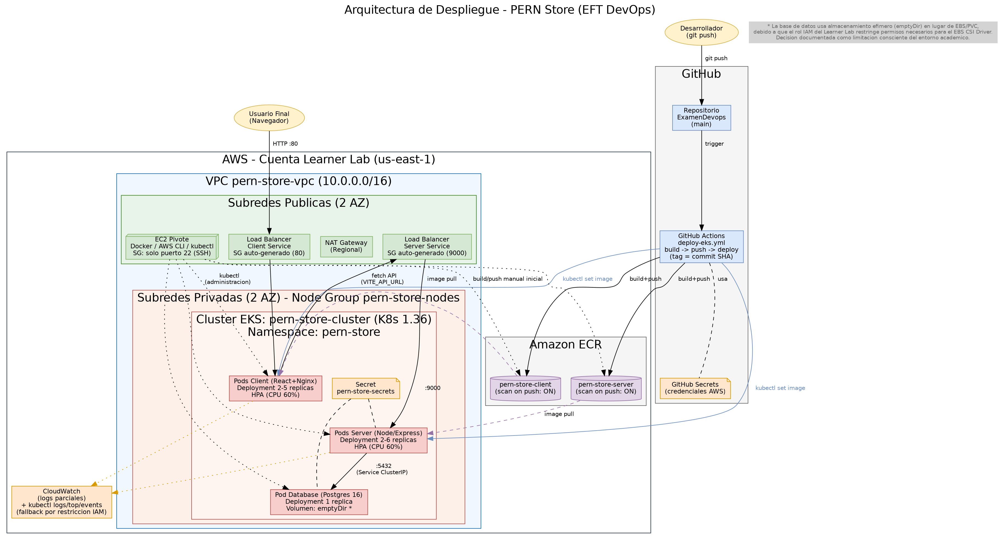

# PERN Store — Proyecto EFT DevOps

Evaluación Final Transversal — Introducción a Herramientas DevOps

Este repositorio contiene el despliegue completo de una aplicación **PERN** (PostgreSQL + Express + React + Node) automatizado mediante prácticas DevOps: contenerización, integración continua, despliegue continuo y orquestación en la nube sobre **Amazon EKS**.

> **Nota de alcance:** el objetivo de esta evaluación es demostrar competencias de **DevOps** (contenerización, CI/CD, infraestructura como servicio, orquestación, observabilidad y seguridad), no el desarrollo de la aplicación en sí. La base de la aplicación (frontend/backend/estructura de base de datos) proviene de un proyecto open-source ([PERN-Store](https://github.com/dhatGuy/PERN-Store)), uso autorizado explícitamente por el docente del ramo. Todo el trabajo de este repositorio —contenerización, infraestructura, pipeline y despliegue— es implementación propia.

## Arquitectura



La aplicación se despliega en un clúster de **Amazon EKS**, dentro de una VPC propia con subredes públicas y privadas. El frontend y el backend corren en pods separados, con autoescalado horizontal (HPA) y recuperación automática ante fallos (self-healing). Las imágenes se publican en **Amazon ECR** con escaneo automático de vulnerabilidades, y el ciclo de integración y despliegue continuo se gestiona con **GitHub Actions**.

Componentes principales:
- **Frontend:** React + Vite, servido por Nginx (imagen multietapa)
- **Backend:** Node.js + Express (imagen multietapa)
- **Base de datos:** PostgreSQL 16 (Alpine)
- **Orquestación:** Amazon EKS (Kubernetes 1.36), Node Group con autoescalado
- **Registro de imágenes:** Amazon ECR (2 repositorios, escaneo de vulnerabilidades activo)
- **CI/CD:** GitHub Actions (`.github/workflows/deploy-eks.yml`)
- **Infraestructura:** VPC con subredes públicas/privadas, NAT Gateway, Security Groups segmentados

## Estructura del repositorio

```
├── client/                  # Frontend React
│   ├── Dockerfile            # Build multietapa (Vite + Nginx)
│   ├── Dockerfile.dev         # Entorno de desarrollo con hot-reload
│   └── nginx.conf
├── server/                  # Backend Express
│   ├── Dockerfile            # Build multietapa (Node Alpine)
│   └── Dockerfile.dev         # Entorno de desarrollo con hot-reload
├── k8s/                     # Manifiestos de Kubernetes
│   ├── namespace.yaml
│   ├── secrets.yaml
│   ├── database.yaml
│   ├── server.yaml            # Deployment + Service + HPA
│   └── client.yaml             # Deployment + Service (LoadBalancer) + HPA
├── .github/workflows/
│   └── deploy-eks.yml          # Pipeline CI/CD: build → push (ECR) → deploy (EKS)
├── docker-compose.yml        # Entorno local tipo "producción"
├── docker-compose.dev.yml     # Entorno local de desarrollo (hot-reload)
└── arquitectura_pern_store.png
```

## Ejecución local (Docker Compose)

Requiere Docker y Docker Compose instalados.

**Entorno de desarrollo (hot-reload):**
```bash
docker compose -f docker-compose.dev.yml up -d
```

**Entorno de producción local:**
```bash
docker compose up -d --build
```

Verificar estado de los servicios:
```bash
docker compose ps
```

Acceso:
- Frontend: http://localhost:3001
- Backend: http://localhost:9000/api

## Despliegue en la nube (resumen)

1. **Infraestructura:** VPC con 2 subredes públicas y 2 privadas, NAT Gateway regional, instancia EC2 pivote (administración vía SSH) y clúster EKS con Node Group en subredes privadas.
2. **Registro de imágenes:** build y push manual inicial a Amazon ECR, con escaneo de vulnerabilidades activado.
3. **Orquestación:** aplicación de manifiestos en orden (`namespace` → `secrets` → `database` → `server` → `client`).
4. **Automatización:** GitHub Actions ejecuta build, push a ECR (tag = SHA del commit) y actualización del Deployment en EKS (`kubectl set image`) en cada push a `main`.
5. **Verificación:** acceso público a la aplicación mediante los Load Balancers provisionados automáticamente por los Services de Kubernetes.

## Limitaciones conocidas del entorno (AWS Academy Learner Lab)

Este proyecto se desarrolló sobre un entorno de laboratorio académico con restricciones de permisos IAM (rol `LabRole` fijo, sin capacidad de crear ni modificar roles). Esto impactó dos decisiones técnicas documentadas explícitamente:

- **Base de datos con almacenamiento efímero (`emptyDir`)** en lugar de un volumen persistente EBS, ya que el complemento EBS CSI Driver requiere permisos IAM (`ec2:DescribeAvailabilityZones`, entre otros) no disponibles en el rol del laboratorio.
- **Observabilidad parcial vía CloudWatch**, complementada con herramientas nativas de Kubernetes (`kubectl logs`, `kubectl top`, `kubectl get events`), ya que el complemento de CloudWatch Container Insights requiere una asociación de rol IAM (Pod Identity) no permitida en el laboratorio.

## Tecnologías

React · Vite · Node.js · Express · PostgreSQL · Docker · Amazon EKS · Amazon ECR · GitHub Actions · AWS VPC

## Autores

Claudio Castillo y Dwaith Lopez — Evaluación Final Transversal, Introducción a Herramientas DevOps
